# 🚨 Agentic WarRoom — Plan Review, Critique & Revised Timeline

## Executive Assessment

Your plan is **genuinely excellent** for a hackathon. The problem framing (Toggle Tax), the 3-pane cockpit UI, the state machine design, and the Nexconn SDK primitive mapping are all well-thought-out. But there are **critical issues** that will burn your time if not fixed. Below is my honest review followed by a revised, realistic timeline.

---

## 🔴 Things That Are Stupid / Will Bite You

### 1. Voice Huddle + Whisper Transcription (Stage 4 / Days 9–10) — **CUT IT**

> [!CAUTION]
> This is the #1 time-bomb in your plan. You're spending 2 full days (14% of your sprint) on a feature that:
> - Requires Nexconn **Call SDK** integration (separate from Chat SDK — different package, different auth flow, WebRTC STUN/TURN setup)
> - Requires piping raw audio to Groq's Whisper API (audio capture, encoding, chunking, streaming)
> - Requires rendering live captions back into the chat timeline
> - Adds **zero points** to the core judging criteria (Completeness/UX 50% + Innovation 30%) beyond what the chat-based triage already demonstrates
>
> **Verdict**: Cut entirely. Use those 2 days for polish, edge cases, and the demo video. If you have spare time on Day 12, add a dummy "Voice Huddle" button that shows a toast: "Voice escalation available in production" — judges will understand.

### 2. Your "Hybrid AI" (Local TwIL-8B + Groq) Strategy Is Overcomplicated

> [!WARNING]
> You're building and maintaining TWO inference paths with different behaviors:
> - Local `llama-server` at ~7 tokens/sec with `<think>` tag stripping
> - Groq Cloud at ~560 tokens/sec without `<think>` tags
>
> **The problem**: Judges will **only** see the deployed Groq version. You'll never demo the local model. Yet you're spending Day 1–2 configuring `llama-server`, KV cache tuning (`-c 8192 -np 1`), sliding context truncation, and `<think>` tag extraction.
>
> **Fix**: Start with Groq from Day 1. Add the local fallback **only** if you finish early (Day 12). The `Unified OpenAI-Compatible Client` abstraction is smart — keep it — but don't build the local path until the product works end-to-end on Groq.

### 3. Three Separate Bot Identities in Nexconn — Unnecessary Server API Overhead

The plan provisions 3 persistent bot users (`bot_log_analyzer`, `bot_db_diagnostician`, `bot_deploy_executor`) via Nexconn Server API. This means:
- 3 separate session tokens to manage
- 3 separate `sendMessage` calls with different sender contexts
- Token refresh logic for each bot

**Fix**: Use **1 bot user** (`bot_warroom_agent`) and use `customType` + the `customData.agentName` field to differentiate which agent "persona" is speaking. Your custom card renderer already switches on `customType` (`DIAGNOSTIC_LOG`, `ROOT_CAUSE_ANALYSIS`, `ACTION_CARD`), so the UI already knows who's talking. One bot, three hats. Saves ~4 hours of auth plumbing.

### 4. "In-Channel Directed Messaging" for RBAC — Verify This Actually Exists

> [!IMPORTANT]
> Your plan refers to "In-Channel Directed Messaging" multiple times as a Nexconn primitive that sends a message visible *only* to the Incident Commander inside a group channel. **I found no confirmation of this feature in the Nexconn Chat SDK skill documentation or feature-pattern-map.**
>
> The Nexconn skill's feature map classifies many advanced features as `⚠️ Pending review`. Directed messaging within a group channel may not exist in the SDK.
>
> **Fallback plan**: Render the "Commander Auth Required" card client-side by checking the current user's role in your React state. All users receive the message, but only the user with `role === "commander"` sees the [Approve] button. This is **application-layer RBAC**, which is the pattern Nexconn's own docs recommend for custom role-gating.

### 5. QoS "High-Priority" Message Routing — Also Verify

Same issue. Your plan repeatedly references `priority: "HIGH"` on messages. The Nexconn skill docs don't explicitly confirm a QoS priority field on `sendMessage`. This might be a custom metadata field you set in `customData` rather than a first-class SDK feature.

**Fix**: Set `priority` inside your `customData` JSON. Your backend orchestrator already controls message ordering (sequential agent chaining), so message delivery order is deterministic regardless of transport-layer QoS.

### 6. Deploying Frontend on Vercel + Backend on Render/Railway — CORS + Cold Start Risk

> [!WARNING]
> - **Render free tier** has cold starts of 30–50 seconds. A judge clicking a Chaos button and waiting 30s for the first agent response = instant bad impression.
> - Cross-origin (Vercel ↔ Render) adds CORS config complexity.
>
> **Fix**: Deploy everything on **Railway** (both frontend static serve and backend). Railway's Hobby plan ($5/month, no cold starts) is worth it for a hackathon demo. Or use a single Vercel project with Vercel Serverless Functions as the backend — but that constrains your Express architecture.

### 7. The RCA Post-Mortem PDF Generator — Low ROI for Hackathon

Building a Markdown/PDF RCA export modal (Stage 4) is cool but:
- Judges won't download and read a PDF during a live demo
- It requires `markdown-pdf` or `puppeteer` dependency + layout work
- It doesn't demonstrate Nexconn SDK usage

**Fix**: Generate RCA as a regular Nexconn chat message with `customType: "RCA_SUMMARY"` rendered as a nice card in-channel. That's the demo. Add the download button as a stretch goal on Day 12.

---

## 🟡 Things That Are Good But Need Adjustment

### 8. The MTTR Timer Sync via Room KV — Smart, But Watch the Update Frequency

Your plan says the MTTR timer updates live across all tabs via Room KV. If you're writing `mttrSeconds` to KV every second, that's heavy. 

**Fix**: Store only `started_at_unix` in KV. Each client computes elapsed time locally via `Date.now() - started_at_unix`. KV updates happen only on state transitions (CRITICAL → DIAGNOSING → RESOLVED), not every tick. Timer freezes when `resolved_at_unix` is set.

### 9. The 3 Chaos Scenarios Are Perfect — But Pre-Bake the LLM Responses

During a live demo, LLM latency (even Groq at <1s) can add up across 3 sequential agents. If Groq has a hiccup, the demo dies.

**Fix**: Pre-bake deterministic JSON responses for each scenario as fallback. If the LLM returns valid JSON within 5 seconds, use it. If not, inject the pre-baked response. Judges see instant magic either way. Your doc already mentions "deterministic JSON repair parser and fallback template" — make this a Day 1 priority, not an afterthought.

### 10. 14-Day Timeline Has No Buffer Days

Your timeline fills every single day with feature work. No bug-fix days, no "things took longer than expected" buffer. Days 11–12 are "Cloud Deploy & Traction" but deployment always takes longer than planned.

---

## 🟢 Things That Are Genuinely Great

| Element | Why It's Smart |
|---|---|
| **Zero-Navigation 3-Pane Cockpit** | Judges see everything on one screen. No clicking around. |
| **Custom Message Types** (`DIAGNOSTIC_LOG`, `ACTION_CARD`, `RCA_SUMMARY`) | Deep Nexconn SDK integration — exactly what hackathon judges want to see |
| **Incident State Machine** (6 stages in Room KV) | Shows you understand distributed state, not just chat messages |
| **Optimistic UI on Approve button** | Shows you think about race conditions — impressive for a hackathon |
| **"Toggle Tax" problem framing** with HBR/Soroco citations | Strong storytelling for the pitch video |
| **Sequential Agent Chaining** (LogBot → DBAgent → DeployBot) | Clean pipeline architecture, easy to explain, visually satisfying |

---

## ✅ Revised Realistic Timeline (Nov 9 – Nov 22)

```mermaid
flowchart LR
    subgraph Phase1["Phase 1: Foundation (Day 1-2)"]
        A1["Nexconn Console Setup<br/>App Key + Bot User"]
        A2["Monorepo Scaffold<br/>React+Vite+Tailwind + Express+TS"]
        A3["Groq API Integration<br/>Unified LLM Client"]
        A4["Pre-bake Fallback JSONs<br/>for all 3 scenarios"]
    end

    subgraph Phase2["Phase 2: Chaos Engine (Day 3-5)"]
        B1["Chaos Simulator UI<br/>3-button drawer"]
        B2["Group Channel Auto-Provisioning<br/>via Nexconn Server API"]
        B3["Room KV Init<br/>State Machine Setup"]
        B4["Sequential Agent Pipeline<br/>LogBot→DBAgent→DeployBot"]
    end

    subgraph Phase3["Phase 3: War Room UI (Day 6-8)"]
        C1["Custom Card Renderers<br/>DIAGNOSTIC_LOG + ACTION_CARD"]
        C2["HITL Approve/Reject Flow<br/>Optimistic UI + KV Mutation"]
        C3["Incident Banner Bar<br/>Severity + MTTR Timer"]
        C4["Application-Layer RBAC<br/>Commander-only buttons"]
    end

    subgraph Phase4["Phase 4: Polish + Deploy (Day 9-11)"]
        D1["RCA Summary Card<br/>in-channel render"]
        D2["Edge Cases + Error Handling<br/>LLM timeout fallbacks"]
        D3["Deploy to Railway<br/>Full-stack single platform"]
        D4["Traction: Live drills<br/>with 5-10 dev peers"]
    end

    subgraph Phase5["Phase 5: Ship It (Day 12-14)"]
        E1["🔥 Buffer Day<br/>Fix what's broken"]
        E2["Record 2.5min Demo Video<br/>Script + Loom"]
        E3["Compile Submission PDF<br/>App Key + Citations + Screenshots"]
    end

    Phase1 --> Phase2 --> Phase3 --> Phase4 --> Phase5
```



### Day-by-Day Breakdown

| Day | Date | Focus | Deliverables | Risk Mitigation |
|---|---|---|---|---|
| **1** | Nov 9 (today) | **Project Bootstrap** | Nexconn Console app created, App Key extracted. Monorepo scaffolded (`/client` React+Vite+Tailwind, `/server` Express+TS). Groq LLM client working. Bot user provisioned in Nexconn. | Start with Groq only. No local llama-server today. |
| **2** | Nov 10 | **Nexconn SDK Wiring** | Nexconn Chat SDK initialized in React client. WebSocket connection verified. Human user can connect and see a channel. Server can send messages as bot. Pre-baked fallback JSON for all 3 scenarios written. | Use `@nexconn/chat` (Chat SDK, not Chat UI) — you need full custom rendering control. |
| **3** | Nov 11 | **Chaos Engine Backend** | `POST /api/incidents/trigger` creates a Nexconn Group Channel, sets Room KV (`status: CRITICAL`), posts raw stack trace. All 3 scenario payloads tested. | Test each scenario end-to-end via Postman before touching UI. |
| **4** | Nov 12 | **Chaos Simulator UI + Agent Pipeline** | Chaos drawer in React with 3 buttons. Clicking triggers channel creation + navigates to it. Sequential agent pipeline (`LogBot → DBAgent → DeployBot`) calls Groq and posts responses to channel. | If Groq is slow, fallback JSON auto-injects. |
| **5** | Nov 13 | **Agent Pipeline Polish** | All 3 agents produce well-structured JSON for all 3 scenarios. Typing indicators show during agent processing. Error handling for malformed LLM output. | Run each scenario 5+ times to catch flaky prompts. |
| **6** | Nov 14 | **Custom Card Renderers** | `DIAGNOSTIC_LOG` card shows file path, line number, code snippet with syntax highlighting. `ACTION_CARD` shows command preview + Approve/Reject buttons. Basic styling. | Use a simple card component pattern — don't over-engineer. |
| **7** | Nov 15 | **HITL Flow + State Machine** | Approve button → KV mutation → card state updates → banner turns green. Reject → loops back to DIAGNOSING. State machine fully wired. MTTR timer computed client-side from `started_at_unix`. | Test with 2 browser tabs to verify KV sync works. |
| **8** | Nov 16 | **3-Pane Layout + Banner** | Full cockpit layout: Left (Chaos + Rooms), Center (Chat), Right (Telemetry/AI Trace). Incident banner with severity badge + live timer. Active incidents list. | Responsive design is NOT needed — judges use desktop. |
| **9** | Nov 17 | **RCA + Right Pane** | `RCA_SUMMARY` card auto-generated on resolution. Right pane shows simulated metrics (CPU, error rate, pods) from Room KV. AI thinking trace shows agent reasoning steps. | Metrics are simulated — hardcode realistic values per scenario. |
| **10** | Nov 18 | **Edge Cases + Hardening** | Multiple incidents running simultaneously. Channel switching. Reconnection handling. LLM timeout fallback. JSON parse error recovery. | This is your safety net day. Don't add features. |
| **11** | Nov 19 | **Deploy + Smoke Test** | Full-stack deployed to Railway. Environment variables configured. End-to-end smoke test with real Nexconn WebSocket. Share URL with 2-3 friends for feedback. | Deploy early enough to fix issues found in production. |
| **12** | Nov 20 | **Traction + Buffer** | Run live drills with 5-10 dev peers. Collect MAU metrics from Nexconn Console. Fix any bugs found during drills. *Optional*: Add voice huddle placeholder button. | Screenshot Nexconn Console showing real MAU numbers. |
| **13** | Nov 21 | **Demo Video** | Script the 2.5-minute Loom video. Record with clean data (fresh incidents). Show: trigger → diagnose → approve → resolve cycle. | Record 3 takes, pick the best. Script it word-by-word. |
| **14** | Nov 22 | **Submission** | Compile PDF: Nexconn App Key on page 1, architecture diagrams, traction screenshots, citations. Final proofread. Submit before deadline. | Submit 2 hours early. Things break at the last minute. |

---

## Nexconn SDK Integration Notes (from nexconn-chat skill)

> [!NOTE]
> The `nexconn-chat` skill has been installed at `.agents/skills/nexconn-chat/`. Key findings from the SDK docs:

### SDK Selection: Chat SDK (NOT Chat UI)

Per the [SDK Integration Decision Framework](file:///home/shin/Downloads/nexconn_chatapp_Hackathon/.agents/skills/nexconn-chat/references/sdk-integration-decision-framework.md), you need **Chat SDK** (not Chat UI) because:
- You're building fully custom card renderers (ACTION_CARD, DIAGNOSTIC_LOG)
- You need custom message bubble layouts
- Chat UI's Web Components lock layout direction and DOM hierarchy — your 3-pane cockpit requires full control

### Authentication Flow

Per [credentials-and-token.md](file:///home/shin/Downloads/nexconn_chatapp_Hackathon/.agents/skills/nexconn-chat/references/credentials-and-token.md):
1. **App Key** → public, goes in client-side init (`NCEngine.initialize`)
2. **App Secret** → **NEVER in client code**. Server-side only for token signing.
3. **Token** → Server generates per-user session tokens. Your Express backend signs them with App Secret and passes to React client.
4. For the hackathon bot user, generate a long-lived token server-side at startup.

### Custom Message Types — This Is Your Superpower

From [feature-pattern-map.md](file:///home/shin/Downloads/nexconn_chatapp_Hackathon/.agents/skills/nexconn-chat/references/feature-pattern-map.md):
- Custom message types with `customType` and `customData` are ✅ **SDK-supported**
- Register your types: `DIAGNOSTIC_LOG`, `ROOT_CAUSE_ANALYSIS`, `ACTION_CARD`, `RCA_SUMMARY`
- Render custom cards via your own React components keyed on `customType`
- Use `customData` for structured payloads (action parameters, confidence scores, etc.)

### Room KV — Check API Docs

Room KV is mentioned in your architecture but the skill docs don't detail the exact API. Before Day 2, run:
```bash
cd /home/shin/Downloads/nexconn_chatapp_Hackathon/.agents/skills/nexconn-chat
bash scripts/fetch-docs.sh /chatsdk-web.md
rg -n "key.value\|room.*kv\|metadata\|channel.*attribute" references/cache/chatsdk-web.md
```

### What's Application-Layer (YOU Build It, Not SDK)

Per [application-layer-rules.md](file:///home/shin/Downloads/nexconn_chatapp_Hackathon/.agents/skills/nexconn-chat/references/application-layer-rules.md):
- ❌ Role-based button visibility (Commander-only approve) → **App-layer**
- ❌ Message character limits → **App-layer**
- ❌ Custom time windows (edit/recall) → **App-layer**
- ✅ Custom message types → **SDK-supported**
- ⚠️ Directed messaging within group → **Pending review** (likely app-layer)

### API Reference Links

| Component | Documentation |
|---|---|
| Chat UI for Web | https://docs.nexconn.ai/apidoc/nexconnchatui-web/latest/en_US/ |
| Chat SDK for Web | https://docs.nexconn.ai/apidoc/nexconnchat-web/latest/en_US/ |
| Chat UI Source (Web) | https://github.com/NexconnAI-Dev/nexconn-chatui-web.git |

---

## Recommended Monorepo Structure

```
nexconn_chatapp_Hackathon/
├── client/                          # React + Vite + Tailwind
│   ├── src/
│   │   ├── components/
│   │   │   ├── ChaosDrawer.tsx       # 3-button chaos simulator panel
│   │   │   ├── WarRoomLayout.tsx     # 3-pane cockpit layout
│   │   │   ├── IncidentBanner.tsx    # Top-bar SEV-1/RESOLVED + MTTR timer
│   │   │   ├── ChatPane.tsx          # Center pane — Nexconn messages
│   │   │   ├── TelemetryPane.tsx     # Right pane — metrics + AI trace
│   │   │   ├── cards/
│   │   │   │   ├── DiagnosticLogCard.tsx
│   │   │   │   ├── ActionCard.tsx     # Approve/Reject buttons
│   │   │   │   ├── RootCauseCard.tsx
│   │   │   │   └── RCASummaryCard.tsx
│   │   │   └── ChannelList.tsx       # Left pane — active incidents
│   │   ├── hooks/
│   │   │   ├── useNexconn.ts         # SDK init, connect, channel events
│   │   │   ├── useRoomKV.ts          # Subscribe to KV mutations
│   │   │   └── useIncident.ts        # State machine transitions
│   │   ├── lib/
│   │   │   ├── nexconnClient.ts      # Nexconn Chat SDK wrapper
│   │   │   └── types.ts             # Custom message type definitions
│   │   ├── App.tsx
│   │   └── main.tsx
│   ├── index.html
│   ├── vite.config.ts
│   ├── tailwind.config.ts
│   └── package.json
├── server/                          # Express + TypeScript
│   ├── src/
│   │   ├── routes/
│   │   │   ├── incidents.ts         # POST /trigger, POST /execute
│   │   │   └── auth.ts             # Token generation endpoint
│   │   ├── agents/
│   │   │   ├── logBot.ts           # @LogBot system prompt + parser
│   │   │   ├── dbAgent.ts          # @DBAgent system prompt + parser
│   │   │   └── deployBot.ts        # @DeployBot system prompt + parser
│   │   ├── services/
│   │   │   ├── llmRouter.ts        # Unified Groq client (local fallback later)
│   │   │   ├── nexconnService.ts   # Server SDK: create channels, send msgs, update KV
│   │   │   └── chaosEngine.ts      # 3 scenario payloads (stack traces, metrics)
│   │   ├── data/
│   │   │   └── fallbackResponses.ts # Pre-baked agent responses per scenario
│   │   ├── app.ts
│   │   └── index.ts
│   ├── tsconfig.json
│   └── package.json
├── DOcs/                            # Your existing design docs
├── .agents/skills/nexconn-chat/     # Nexconn skill (installed ✅)
└── README.md
```

---

## Summary: What Changed vs Your Original Plan

| Your Plan | My Revision | Reason |
|---|---|---|
| Voice Huddle + Whisper (Days 9-10) | **Cut entirely** | High complexity, low judging ROI, separate Call SDK |
| Local TwIL-8B + Groq dual setup (Day 1-2) | **Groq-only first** | Judges only see deployed version |
| 3 bot users in Nexconn | **1 bot user, 3 personas** | Saves auth plumbing time |
| In-Channel Directed Messaging | **App-layer RBAC** | SDK feature unverified |
| QoS High-Priority Messages | **Priority in customData** | SDK feature unverified |
| Frontend Vercel + Backend Render | **Both on Railway** | No cold starts, no CORS |
| RCA PDF export | **RCA as in-channel card** | Judges won't download a PDF |
| No buffer days | **Day 10 = hardening, Day 12 = buffer** | Things always break |
| MTTR via KV every second | **Client-side timer from `started_at_unix`** | Less KV write pressure |
| Fallback JSON as afterthought | **Day 1 priority** | Protects demo from LLM failures |

> [!TIP]
> **The golden rule for hackathon demos**: If a judge can't see the feature working in your 2.5-minute video, it doesn't exist. Every hour you spend should make the demo more impressive, not the architecture more elegant.
